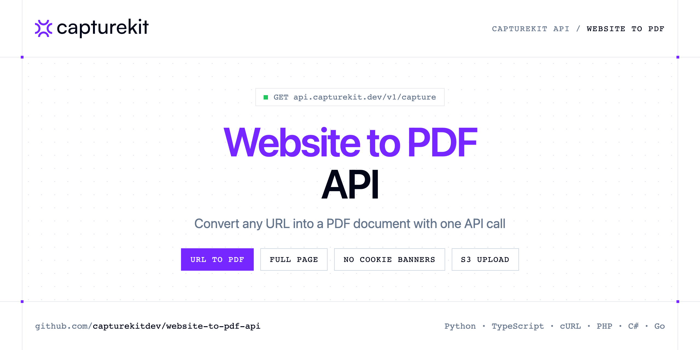

<p align="center">
  <a href="https://www.capturekit.dev"></a>
</p>

# Website to PDF API

[](https://discord.gg/CFj3ph8aHU) [](https://app.capturekit.dev/register) [](https://app.capturekit.dev/openapi) [](LICENSE)

Turn any web page into a **PDF** with the CaptureKit capture endpoint (`format=pdf`). The response body is the PDF file.

- **Website to PDF API** — Browser-like Screenshot API that captures webpages as PNG/JPEG/WebP or PDF for previews, QA, reporting, monitoring, and archiving no headless setup.

Use it for invoices and receipts pages, reports, legal archiving or offline reading.

| Endpoint | Request | Credits |
|---|---|---|
| [Website to PDF API](#website-to-pdf-api) | `GET /v1/capture` | 1 |

## Table of contents

- [How it works](#how-it-works)
- [Website to PDF API](#website-to-pdf-api)
- [Code examples in other languages](#code-examples-in-other-languages)
- [Use cases](#use-cases)
- [Why CaptureKit?](#why-capturekit)
- [FAQ](#faq)
- [Related repositories](#related-repositories)
- [Support](#support)

## How it works

1. **Create a CaptureKit account** and copy your API key from the [dashboard](https://app.capturekit.dev/register).
2. **Call `https://api.capturekit.dev`** with the header `x-api-key: YOUR_API_KEY`.
3. **Use the result** in your app — no infrastructure to run.

```bash
export CAPTUREKIT_API_KEY="your-api-key"
pip install requests        # Python
# TypeScript: Node.js 18+ (native fetch), run with `npx tsx file.ts`
```

## Website to PDF API

Browser-like Screenshot API that captures webpages as PNG/JPEG/WebP or PDF for previews, QA, reporting, monitoring, and archiving no headless setup.

`GET https://api.capturekit.dev/v1/capture` · **1 credit per request** · [API reference](https://app.capturekit.dev/openapi)

### Request parameters

| Parameter | In | Type | Required | Description |
|---|---|---|---|---|
| `url` | query | string | ✅ | The URL of the webpage to capture. Examples: ``` https://www.amazon.com/s?k=pokemon ``` |
| `format` | query | string (`jpeg`, `jpg`, `pdf`, `png`, `webp`) | — | The output format of the screenshot. |
| `device` | query | string (`galaxy_fold4`, `galaxy_s23`, `galaxy_s23_ultra`, `galaxy_s8`, `huawei_mate_50_pro`, `huawei_p60_pro`) | — | The device type to emulate for the screenshot. |
| `full_page` | query | boolean | — | Capture the entire page instead of just the visible viewport. |
| `full_page_scroll` | query | boolean | — | Scroll the page to fully load lazy-loaded elements before capturing a full-page screenshot. |
| `full_page_scroll_duration` | query | number | — | Time in milliseconds for scrolling before capturing the full page. |
| `viewport_width` | query | number | — | The width of the browser viewport in pixels. |
| `viewport_height` | query | number | — | The height of the browser viewport in pixels. |
| `scale_factor` | query | number | — | The scale factor for high-resolution screenshots. |
| `image_quality` | query | string | — | Generate images with custom quality settings. |
| `selector` | query | string | — | Capture a specific element on the page instead of the full viewport. |
| `cache` | query | boolean | — | Cache the response. |
| `cache_ttl` | query | number | — | Cache the response for a custom TTL (in seconds). |
| `remove_selectors` | query | string | — | A comma-separated list of elements to hide before capturing (e.g., ads, popups). |
| `remove_cookie_banners` | query | boolean | — | Automatically remove cookie banners before capturing. |
| `remove_ads` | query | boolean | — | Automatically remove ads before capturing. |
| `block_resources` | query | string (`document`, `eventsource`, `fetch`, `font`, `image`, `manifest`) | — | Comma-separated list of resource types to block (e.g., “image,stylesheet,font”). |
| `block_urls` | query | string | — | Comma-separated list of URL patterns to block (e.g., “analytics,tracking,advertisement”). |
| `delay` | query | number | — | Delay in seconds before capturing the screenshot. |
| `wait_until` | query | array (`domcontentloaded`, `load`, `networkidle0`, `networkidle2`) | — | Define when to capture. |
| `wait_for_selector` | query | string | — | Wait for a specific element to appear before taking the screenshot. |
| `proxy` | query | string | — | Specify a proxy server to route your request through. |
| `s3_secret_key` | query | string | — | AWS S3 secret access key. |
| `s3_access_key_id` | query | string | — | AWS S3 access key ID. |
| `s3_bucket` | query | string | — | The S3 bucket name where the screenshot will be uploaded. |
| `s3_object_key` | query | string | — | The filename for the S3 object (auto-generated if not provided). |
| `s3_region` | query | string | — | AWS S3 region for storage. |
| `storage_endpoint` | query | string | — | Leave this field empty for AWS S3. Only specify a value if required. S3-compatible storage services are supported, for example, use https://<accountId>.r2.cloudflarestorage.com for Cloudflare R2. |
| `s3_url` | query | boolean | — | Use S3 storage for screenshots. The S3 URL will be returned in the response. |

### Python example

```python
import os

import requests

API_KEY = os.environ["CAPTUREKIT_API_KEY"]
HEADERS = {"x-api-key": API_KEY}

response = requests.get(
    "https://api.capturekit.dev/v1/capture",
    headers=HEADERS,
    params={
        "url": "https://github.com/seaweedfs/seaweedfs",
        "format": "pdf",
    },
    timeout=120,
)
response.raise_for_status()

with open("page.pdf", "wb") as f:
    f.write(response.content)
print("Saved page.pdf", len(response.content), "bytes")
```

### TypeScript example

```typescript
import { writeFile } from "node:fs/promises";

const headers = { "x-api-key": process.env.CAPTUREKIT_API_KEY!, "Content-Type": "application/json" };

const params = new URLSearchParams({
  "url": "https://github.com/seaweedfs/seaweedfs",
  "format": "pdf",
});

const response = await fetch(`https://api.capturekit.dev/v1/capture?${params}`, { headers });
if (!response.ok) throw new Error(`HTTP ${response.status}: ${await response.text()}`);

await writeFile("page.pdf", Buffer.from(await response.arrayBuffer()));
console.log("Saved page.pdf");
```

### Output

The response body is the generated file (saved as `page.pdf` in every example). Error responses are JSON with an explanatory message.

## Code examples in other languages

Ready-to-run examples live in [`examples/`](examples); each reads your key from `CAPTUREKIT_API_KEY`.

| Language | `pdf` |
|---|---|
| cURL (Bash) | [pdf.sh](examples/curl/pdf.sh) |
| PHP | [pdf.php](examples/php/pdf.php) |
| C# | [Pdf.cs](examples/csharp/Pdf.cs) |
| Go | [pdf.go](examples/go/pdf.go) |
| Java | [PdfExample.java](examples/java/PdfExample.java) |
| Ruby | [pdf.rb](examples/ruby/pdf.rb) |
| Node.js | [pdf.mjs](examples/nodejs/pdf.mjs) |

## Use cases

- **Archiving** — Keep PDF copies of pages for compliance or evidence.
- **Reports** — Export dashboards or pages as shareable PDFs.
- **Offline reading** — Save articles and docs as PDF.

## Why CaptureKit?

- **Screenshots as a service** — the response body *is* the image or PDF; save it or upload it straight to your S3 bucket.
- **Pixel-perfect options** — full page, viewport size, scale factor, element `selector`, 18 mobile/tablet devices, delays and wait conditions.
- **Clean pages** — remove cookie banners, ads and any CSS selector before capturing.
- **Beyond screenshots** — extract content (metadata, links, HTML, Markdown) or get an AI analysis of any page.
- **Copy-paste examples** — Python and TypeScript in each README, 7 more languages in `examples/`.

## FAQ

### How do I authenticate?

Create an account on [CaptureKit](https://app.capturekit.dev/register), copy your API key and send it in the `x-api-key` header of every request to `https://api.capturekit.dev`.

### How much does a request cost?

Credits per call: `/v1/capture` **1**. See [CaptureKit pricing](https://www.capturekit.dev/pricing).

### What does the API return?

The response body is the file itself (image or document). Save it directly to disk or stream it to your storage — every example in this repository writes the file locally.

### Which languages are supported?

Any language that can make an HTTP request. This README shows Python and TypeScript; the [`examples/`](examples) folder contains cURL, PHP, C#, Go, Java, Ruby and Node.js.

## Related repositories

- [Screenshot API](https://github.com/capturekitdev/screenshot-api)
- [Full Page Screenshot API](https://github.com/capturekitdev/full-page-screenshot-api)
- [Mobile Screenshot API](https://github.com/capturekitdev/mobile-screenshot-api)
- [Website Content API](https://github.com/capturekitdev/website-content-api)
- [AI Website Analyzer API](https://github.com/capturekitdev/ai-website-analyzer-api)
- [Website Crawler API](https://github.com/capturekitdev/website-crawler-api)
- [All CaptureKit repositories](https://github.com/capturekitdev)

## Support

- 💬 Join the [Discord](https://discord.gg/CFj3ph8aHU) to ask questions and share what you build.
- 📚 Read the [API reference](https://app.capturekit.dev/openapi).
- 🔑 [Get your API key](https://app.capturekit.dev/register).

---

<p align="center">
  <a href="https://www.capturekit.dev">
    <picture>
      <source media="(prefers-color-scheme: dark)" srcset="images/logo-dark.svg">
      
    </picture>
  </a>
  <br>
  <sub>Built by <a href="https://www.capturekit.dev">CaptureKit</a>. Examples are released under the MIT license.</sub>
</p>
